# ArkWatch

macOS 菜单栏上的火山方舟（Volcengine Ark）用量监控，原生 Swift/AppKit + SwiftUI，无第三方依赖。



## 功能

- **菜单栏常驻**：大号数值（13pt）+ 左上角蓝色小字说明（剩余 / 已用 / 剩余 AFP，上标排版不重叠）；在设置里切换显示项立即生效，无 Dock 图标。
- **四个额度窗口**：5 小时、今日、本周、本月，各自显示 已用 / 配额、进度条、重置倒计时。
- **模型用量**：今日各模型消耗的 Token 排名，套餐外用量带“超额”标记。
- **套餐识别**：自动识别 Agent Plan（Small / Medium / Large / Max）与 Coding Plan（Lite / Pro），并显示状态、到期时间、是否自动续费。
- **套餐面板**：入口统一收在右上角齿轮 → 设置 →「查看全部套餐」。窗口标题为「全部套餐」，打开时自动检测开通状态（检测中显示黄色标签），各档带红绿灯（绿=已开通，红=未开通）、价格与额度；「开通」跳转控制台，「切换」仅切换本机查看对象（不改变实际订阅）。
- **多账号**：支持添加、编辑、删除多个账号（账号 = Access Key ID，密码 = Secret Access Key），菜单里一键切换；密码只进系统钥匙串，不落明文。
- **实时刷新**：默认 60 秒，可设 30 秒 / 2 分钟 / 5 分钟；点击图标立即刷新一次。
- **外观设置**：设置栏与菜单栏的缩放（80%–150%，5% 步进）改为下拉选择；整体外观支持 跟随系统 / 浅色 / 深色。所有下拉框统一 130pt、右对齐。
- **开机自启**：通过 LaunchAgent 实现，无需开发者证书。
- **命令行工具**：`--selftest` 校验签名实现，`--probe` 直接打印用量（便于排障）。

## 快速开始

```bash
cd ArkWatch
./build.sh            # 编译并生成 dist/ArkWatch.app
open dist/ArkWatch.app
```

首次运行菜单栏会显示 `Ark ⚙`：

1. 点击菜单栏图标 → 右上角「登录」→「添加账号…」
2. 「账号」填 **Access Key ID**（AKLT 开头），「密码」填 **Secret Access Key**
   （两个输入框右侧都有剪贴板按钮，复制后可一键粘贴，自动去掉首尾空白与换行）
   （两者在控制台 → 访问控制 → API 访问密钥 创建）
3. 点「测试连接」确认，再「保存」

添加完成后菜单栏即显示本月剩余百分比，点开可看四个窗口和模型用量。

## 账号与切换

- 所有账号保存在 `~/Library/Application Support/ArkWatch/accounts.json`（AK 与备注，权限 0600）。
- Secret Key 存入 macOS 钥匙串（service `com.joco.arkwatch`），随账号删除而清理。
- 菜单里的账号列表带勾选标记，点击即切换，切换后立即重新拉取数据。
- 设置窗口可编辑账号名称、替换 SK、删除账号。

> 这里的“登录”指的是用 AK/SK 授权调用方舟 OpenAPI。火山引擎控制台的网页登录态无法被第三方程序复用，AK/SK 是官方唯一支持的自动化鉴权方式。

## 数据来源

| 用途 | OpenAPI | 说明 |
|---|---|---|
| 四个窗口 AFP 额度 | `GetAFPUsage` | 仅个人版 Agent Plan；返回 5 小时 / 近一天 / 近一周 / 近一月配额与已用 |
| 套餐档位与状态 | `GetPersonalPlan` | 分别查询 `AgentPlan`、`CodingPlan`，取生效中的那个 |
| 今日模型 Token | `GetUsageDetails` | 按天/小时聚合，含 `WithinPlan` / `OutsideOfPlan` |
| 支持模型列表 | `ListArkAgentPlanModel` | 预留能力，当前界面未直接展示 |

- Endpoint：`https://ark.cn-beijing.volcengineapi.com`
- 鉴权：火山引擎 AK/SK 签名（`HMAC-SHA256`，Service=`ark`，Region=`cn-beijing`），本地实现，已用官方测试向量校验。

## 命令行

```bash
# 签名自检（使用官方文档测试向量，输出 PASS/FAIL）
./dist/ArkWatch.app/Contents/MacOS/ArkWatch --selftest

# 直接查询用量，排查问题最快
ARK_AK=AKLT... ARK_SK=... ./dist/ArkWatch.app/Contents/MacOS/ArkWatch --probe
```

`--probe` 输出示例：

```
套餐    : AgentPlan Small 状态 Running 到期 2026-11-19T23:59:59+08:00
窗口	已用	配额	占比
5 小时	812.0	2000.0	40.6%
今日	1050.0	10000.0	10.5%
本周	3120.0	7000.0	44.6%
本月	9480.0	20000.0	47.4%
```

## 常见问题

**菜单栏显示 `Ark ⚠` 或红色报错**
点击图标看具体错误。常见为 `InvalidAccessKey`（AK 写错）或 `SignatureDoesNotMatch`（SK 错误 / 系统时间偏差过大）。

**账号有 AK/SK 但读不到套餐**
- 该接口只支持**个人版** Agent Plan / Coding Plan；企业版席位请用 `GetSeatAFPUsage` 等接口。
- 账号未购买套餐时 `GetPersonalPlan` 返回 `ResourceNotFound.Plan`，属正常。

**Coding Plan 看不到 AFP 进度条**
`GetAFPUsage` 目前只覆盖 Agent Plan，Coding Plan 会显示套餐信息与模型用量，额度窗口为空。

**为什么数据比控制台慢**
官方说明模型调用明细有 0.5–1 天延迟，AFP 窗口本身是滚动统计，可能与本机时间存在分钟级差异。

**开机自启没生效**
检查 `~/Library/LaunchAgents/com.joco.arkwatch.plist` 是否存在；移动过 App 位置后需重新开关一次该选项。

## 目录结构

```
ArkWatch/
├── Sources/
│   ├── main.swift        # 入口、菜单栏、弹窗、CLI 模式
│   ├── Signing.swift     # AK/SK 签名 + 官方向量自检
│   ├── ArkAPI.swift      # OpenAPI 客户端与数据模型
│   ├── Store.swift       # 账号仓库、钥匙串、偏好、开机自启
│   ├── AppModel.swift    # 轮询、状态聚合、菜单栏文案
│   └── UI.swift          # SwiftUI 面板与设置界面
├── tools/make-icon.swift # 生成 App 图标
├── build.sh              # 一键构建 .app
└── dist/ArkWatch.app     # 产物
```

## 安全说明

- 程序只与本机 `ark.cn-beijing.volcengineapi.com` 通信，不经过任何中转服务。
- Secret Key 不写入配置文件，只在内存与系统钥匙串中出现。
- 建议使用**子账号 AK** 并仅授予方舟相关只读权限，降低泄露风险。
