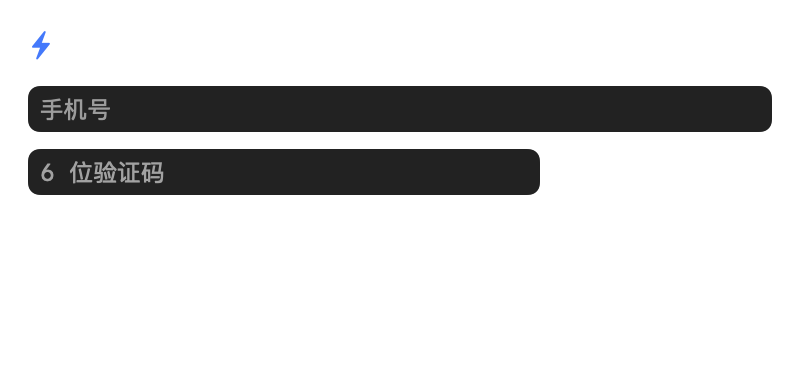

# ArkWatch

macOS 菜单栏上的火山方舟（Volcengine Ark）用量监控，原生 Swift/AppKit + SwiftUI，无第三方依赖。

手机号 + 验证码登录，登录态保存在钥匙串，重启后自动恢复，直到你主动点击「退出登录」。




## 功能

- **手机号 + 验证码登录**：11 位手机号校验、60 秒重发倒计时、验证码 5 分钟有效；登录后写入本机会话。
- **登录态持久化**：会话存于系统钥匙串，重启 App 或重启电脑后自动恢复，**只有点击「退出登录」才会失效**。
- **菜单栏常驻**：显示本月 AFP 剩余百分比（可切换为已用百分比 / 剩余 AFP 数值），无 Dock 图标。
- **四个额度窗口**：5 小时、今日、本周、本月，各自显示 已用 / 配额、进度条、重置倒计时。
- **模型用量**：今日各模型消耗的 Token 排名，套餐外用量带“超额”标记。
- **套餐识别**：自动识别 Agent Plan（Small / Medium / Large / Max）与 Coding Plan（Lite / Pro），并显示状态、到期时间、是否自动续费。
- **多手机号账号**：每个手机号绑定各自的 AK/SK，退出后可换号登录；Secret Key 只进钥匙串。
- **实时刷新**：默认 60 秒，可设 30 秒 / 2 分钟 / 5 分钟；点开面板立即刷新。
- **开机自启**：LaunchAgent 实现，无需开发者证书。
- **命令行工具**：`--selftest` 验签、`--keychain-test` 验钥匙串、`--probe` 直接打印用量。

## 快速开始

```bash
cd ArkWatch
./build.sh            # 编译并生成 dist/ArkWatch.app
open dist/ArkWatch.app
```

首次运行菜单栏显示 `Ark 登录`：

1. 点击菜单栏图标，输入手机号 → 点「获取验证码」
2. 把界面上显示的 6 位**演示验证码**填入验证码框（60 秒内有效，5 分钟过期）
3. 点「登录」→ 菜单栏变为 `Ark ⚙`
4. 点齿轮「设置」→ 该手机号一行点「绑定 AK」→ 填入 AK/SK →「测试连接」→「保存」
5. 菜单栏开始显示本月剩余百分比

之后无论重启 App 还是重启电脑，都会直接进入已登录状态。

## 登录与会话机制

| 环节 | 实现 |
|---|---|
| 身份标识 | 手机号（11 位、`1[3-9]` 开头校验） |
| 验证码 | **本地演示模式**：App 生成 6 位随机码并显示在登录面板，5 分钟过期，60 秒重发间隔 |
| 会话 | 登录成功写入 `Session{phone, token, loginAt}`，存于钥匙串（service `com.joco.arkwatch.session`） |
| 恢复 | 启动时读取会话，自动登录并刷新数据，无需再次验证 |
| 退出 | 菜单 →「退出登录」或设置页 →「退出登录」，清除会话；手机号账号与 AK/SK **保留**，下次登录可继续用 |

> **重要**：这是**本地登录门禁**，不是真实身份认证。验证码不发短信、不联网校验，只用于把本机 UI 锁在“已登录”状态。火山方舟 OpenAPI 本身只认 AK/SK，没有“手机号换 AK/SK”的公开接口，因此真实身份必须由 AK/SK 承担。

### 想换成真实短信验证码

`Sources/UI.swift` 中的 `LoginModel.sendCode()` / `LoginModel.submit()` 是唯一入口，替换成你的后端即可：

```swift
func sendCode() {
    // POST https://your-api/sms/send  { phone: normalizedPhone }
    // 成功后 secondsLeft = 60
}

func submit(to model: AppModel) {
    // POST https://your-api/sms/verify { phone, code }
    // 后端返回成功后再：model.login(phone: normalizedPhone)
}
```

## 账号与 AK/SK

- 手机号与绑定信息存 `~/Library/Application Support/ArkWatch/accounts.json`（权限 0600，不含 Secret Key）。
- Secret Key 存入 macOS 钥匙串（service `com.joco.arkwatch`，按账号 id 区分），删除账号时一并清理。
- 一个手机号可绑定一套 AK/SK；换号登录不影响已绑定的其他手机号。
- AK/SK 在火山引擎控制台「访问控制 → API 访问密钥」创建。

## 数据来源

| 用途 | OpenAPI | 说明 |
|---|---|---|
| 四个窗口 AFP 额度 | `GetAFPUsage` | 仅个人版 Agent Plan；返回 5 小时 / 近一天 / 近一周 / 近一月配额与已用 |
| 套餐档位与状态 | `GetPersonalPlan` | 分别查询 `AgentPlan`、`CodingPlan`，取生效中的那个 |
| 今日模型 Token | `GetUsageDetails` | 按天/小时聚合，含 `WithinPlan` / `OutsideOfPlan` |
| 支持模型列表 | `ListArkAgentPlanModel` | 预留能力，当前界面未直接展示 |

- Endpoint：`https://ark.cn-beijing.volcengineapi.com`
- 鉴权：火山引擎 AK/SK 签名（`HMAC-SHA256`，Service=`ark`，Region=`cn-beijing`），本地实现，已用官方测试向量校验。

## 命令行

```bash
# 签名自检（官方文档测试向量）
./dist/ArkWatch.app/Contents/MacOS/ArkWatch --selftest

# 钥匙串读写自检（登录态依赖它）
./dist/ArkWatch.app/Contents/MacOS/ArkWatch --keychain-test

# 直接查询用量，排查问题最快
ARK_AK=AKLT... ARK_SK=... ./dist/ArkWatch.app/Contents/MacOS/ArkWatch --probe

# 开发调试：写入 / 清除本机会话与账号
./dist/ArkWatch.app/Contents/MacOS/ArkWatch --session-test
./dist/ArkWatch.app/Contents/MacOS/ArkWatch --reset-state
```

`--probe` 输出示例：

```
套餐    : AgentPlan Small 状态 Running 到期 2026-11-19T23:59:59+08:00
窗口	已用	配额	占比
5 小时	812.0	2000.0	40.6%
今日	1050.0	10000.0	10.5%
本周	3120.0	7000.0	44.6%
本月	9480.0	20000.0	47.4%
```

## 常见问题

**登录后菜单栏还是 `Ark ⚙`**
说明该手机号还没绑定 AK/SK。点齿轮进设置，在对应手机号一行点「绑定 AK」。

**重启后要我重新登录**
正常应自动恢复；若没有，可能是钥匙串条目被清理或 App 被重新签名（重编译后首次读取可能弹一次钥匙串授权，点“始终允许”即可）。

**怎么彻底清掉登录态**
点「退出登录」清会话；再在设置里删除账号即同时清除 Keychain 中的 Secret Key。也可手动删除 `~/Library/Application Support/ArkWatch/accounts.json` 并在「钥匙串访问」里删除 `com.joco.arkwatch.*` 条目。

**菜单栏显示 `Ark ⚠` 或红色报错**
点开面板看具体错误。常见为 `InvalidAccessKey`（AK 写错）或 `SignatureDoesNotMatch`（SK 错误 / 系统时间偏差过大）。

**Coding Plan 看不到 AFP 进度条**
`GetAFPUsage` 目前只覆盖 Agent Plan，Coding Plan 会显示套餐信息与模型用量，额度窗口为空。

**为什么数据比控制台慢**
官方说明模型调用明细有 0.5–1 天延迟，AFP 窗口本身是滚动统计，可能与本机时间存在分钟级差异。

**开机自启没生效**
检查 `~/Library/LaunchAgents/com.joco.arkwatch.plist` 是否存在；移动过 App 位置后需重新开关一次该选项。

## 目录结构

```
ArkWatch/
├── Sources/
│   ├── main.swift        # 入口、菜单栏、弹窗、CLI 模式
│   ├── Signing.swift     # AK/SK 签名 + 官方向量自检
│   ├── ArkAPI.swift      # OpenAPI 客户端与数据模型
│   ├── Store.swift       # 账号仓库、会话、钥匙串、偏好、开机自启
│   ├── AppModel.swift    # 登录态、轮询、状态聚合、菜单栏文案
│   └── UI.swift          # 登录面板、用量面板、设置界面
├── tools/make-icon.swift # 生成 App 图标
├── build.sh              # 一键构建 .app
└── dist/ArkWatch.app     # 产物（不入库）
```

## 安全说明

- 程序只与本机 `ark.cn-beijing.volcengineapi.com` 通信，不经过任何中转服务。
- 手机号、会话 token、Secret Key 均只存在本机（User 配置 + 钥匙串）。
- 演示验证码不联网，也不构成真实认证；若用于团队环境，请先接入自己的短信/身份服务。
- 建议使用**子账号 AK** 并仅授予方舟相关只读权限，降低泄露风险。
